# Long-Document VQA Survey

**A Task-Centric Survey of Long-Document Visual Question Answering: Taxonomy, Evolution, and Future Directions**

Yufei Tong<sup>1</sup>, Guanjie Cheng<sup>2,&#42;</sup>, Tianle Wu<sup>3</sup>, Leilei Zhang<sup>1,&#42;</sup>, Hang Zheng<sup>1,4</sup>, Peihan Wu<sup>1</sup>, Jianwei Yin<sup>1,2</sup>, Shuiguang Deng<sup>1</sup>

<sup>1</sup>College of Computer Science and Technology, Zhejiang University  
<sup>2</sup>School of Software Technology, Zhejiang University  
<sup>3</sup>Polytechnic Institute, Zhejiang University  
<sup>4</sup>BWTON Technology Co., Ltd., China  
<sup>&#42;</sup>Corresponding authors: Guanjie Cheng and Leilei Zhang.

**[Read the full paper](paper/long-document-vqa-survey.pdf) · [Download PDF](https://github.com/yufeiTongZJU/Long-Document-VQA-Survey/raw/refs/heads/main/paper/long-document-vqa-survey.pdf)**

[Framework](#1-task-driven-framework) · [Taxonomy and tables](#2-fine-grained-technical-taxonomy) · [Evolution and future directions](#3-technical-evolution-and-future-directions) · [Citation](#citation)

*The PDF includes the full non-anonymous manuscript, references, and appendices. The arXiv link will be added after release.*

## Abstract

Visual document understanding is essential for acquiring knowledge from visually rich documents and is attracting growing research interest. Existing surveys emphasize architectures or technical approaches, with limited attention to how task bottlenecks shape technical choices and research priorities. We present a task-centric survey that decomposes long-document visual question answering (VQA) into four components: document parsing, evidence organization and retrieval, generator organization and learning, and evaluation. For each, we develop a fine-grained taxonomy and trace motivations, technical responses, and cross-component connections. We focus on explicit retrieval while covering direct reading. Our temporal analysis traces expanding priorities from multimodal content understanding to sufficient, high-fidelity evidence acquisition and sustained evidence management. We outline future directions in evidence sufficiency, verifiable and correctable understanding, and budget-aware coordination, with an outlook on continual document understanding.

## Core contributions

We analyze over 150 papers and organize this survey around task decomposition, fine-grained analysis, and temporal evolution. Our contributions are threefold:

1. **A unified, task-driven framework.** We map requirements for content fidelity, sufficient evidence acquisition, evidence use, and reliable evaluation onto four interconnected components: document parsing, evidence organization and retrieval, generator organization and learning, and evaluation.

2. **A fine-grained technical taxonomy by task function.** We categorize representation and structure, retrieval modalities and granularities, evidence acquisition strategies, reasoning organization and learning objectives, and evaluation capabilities.

3. **Technical evolution and future research directions.** We trace how task bottlenecks shape technical choices as research priorities expand from multimodal understanding to evidence acquisition and sustained management. We identify challenges and future directions in evidence sufficiency, verifiable and correctable understanding, and budget-aware coordination, with an outlook on continual document understanding.

## 1. Task-driven framework

**Explicit retrieval** selects evidence before generation; **direct reading** answers from the supplied document representations. Both share parsing and generation, with evaluation throughout. Feedback can guide further retrieval, rereading, and on-demand parsing.

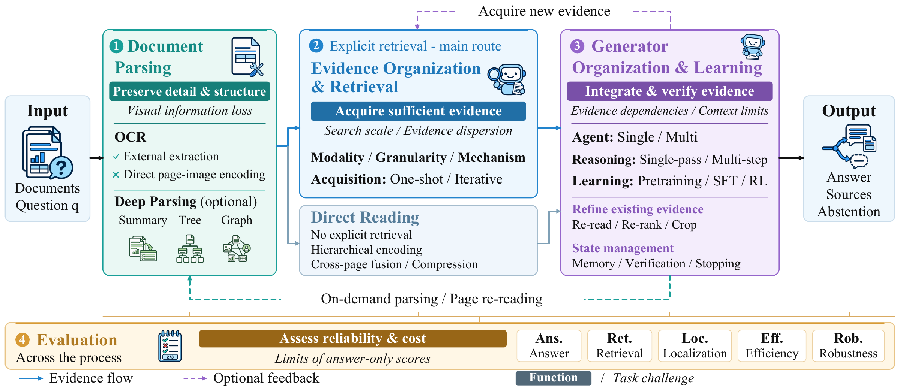

<details>
<summary><strong>Figure 1 · Task challenges and publication trends</strong></summary>

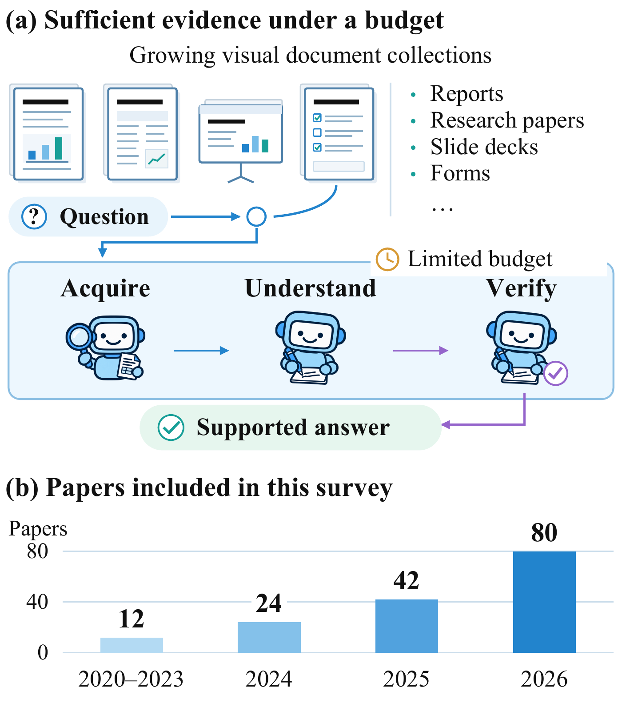

</details>

## 2. Fine-grained technical taxonomy

| Component | Classification dimensions |
| :--- | :--- |
| Document parsing | External extraction dependence (OCR); semantic overviews and explicit relations (Deep Parsing) |
| Evidence organization and retrieval | Matching modality, evidence granularity, retrieval mechanism, acquisition strategy |
| Generator organization and learning | Agent organization, reasoning process, added training |
| Evaluation | Answer correctness, retrieval, localization, efficiency, robustness |

**Iterative acquisition and multi-step reasoning are distinct:** reasoning may revisit existing evidence without retrieving new evidence.

Tables 1–3 compare representative methods and benchmarks. The complete appendix tables are browsable on GitHub, with all classification fields, paper links, dates, and notes.

| Coverage | Representative comparison | Complete table on GitHub |
| :--- | :--- | :--- |
| Explicit retrieval | Table 1 | [Table 6 · 110 methods](papers/explicit-retrieval.md) |
| Direct reading | Table 2 | [Table 5 · 29 methods](papers/direct-reading.md) |
| Benchmarks | Table 3 | [Table 4 · 55 benchmarks](papers/benchmarks.md) |

<details>
<summary><strong>Table 1 · Representative explicit-retrieval methods</strong></summary>

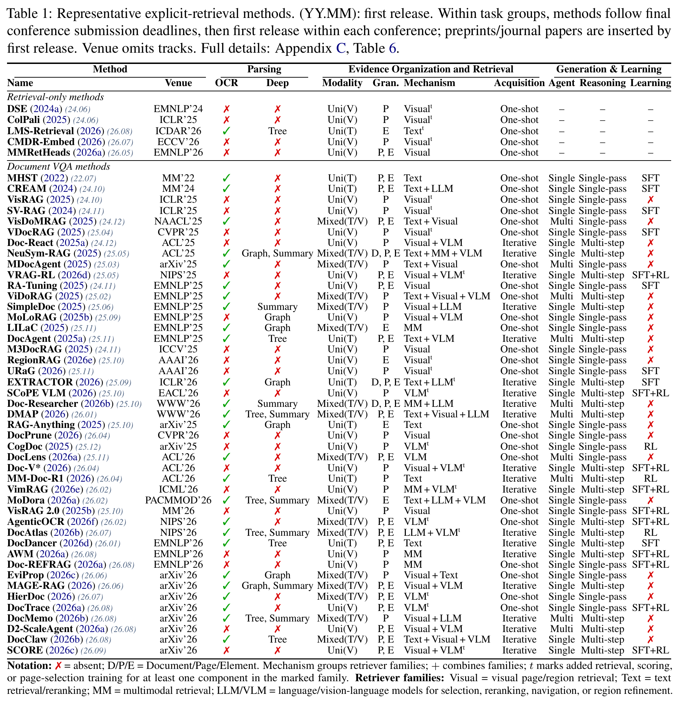

</details>

<details>
<summary><strong>Table 2 · Representative direct-reading methods</strong></summary>

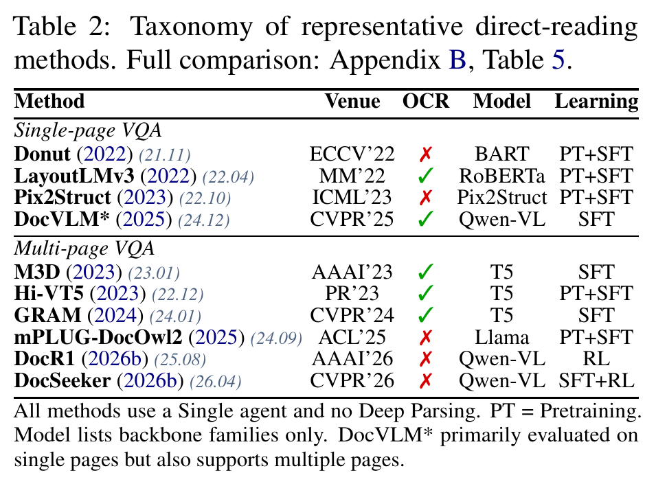

</details>

<details>
<summary><strong>Table 3 · Representative benchmarks</strong></summary>

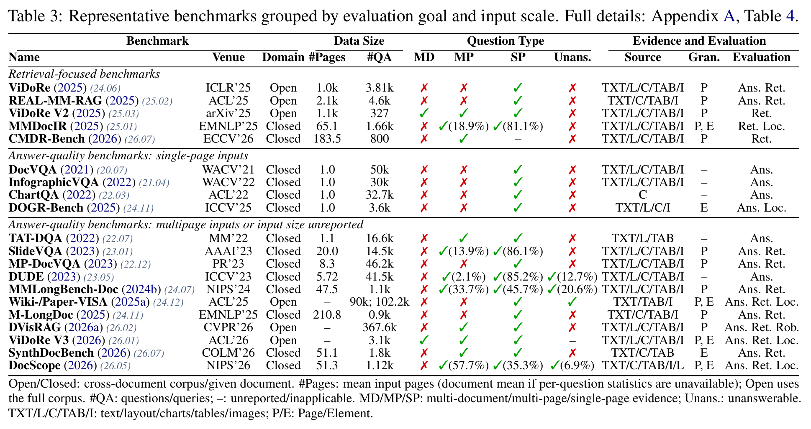

</details>

The tables include single-page foundations and retrieval-only studies; records across tables may refer to the same paper. [BibTeX](references.bib) contains the survey's 165 cited references.

## 3. Technical evolution and future directions

Research priorities broaden from **multimodal content understanding → sufficient, high-fidelity evidence acquisition → sustained evidence management**. These priorities coexist: methods can combine techniques from different stages across components.

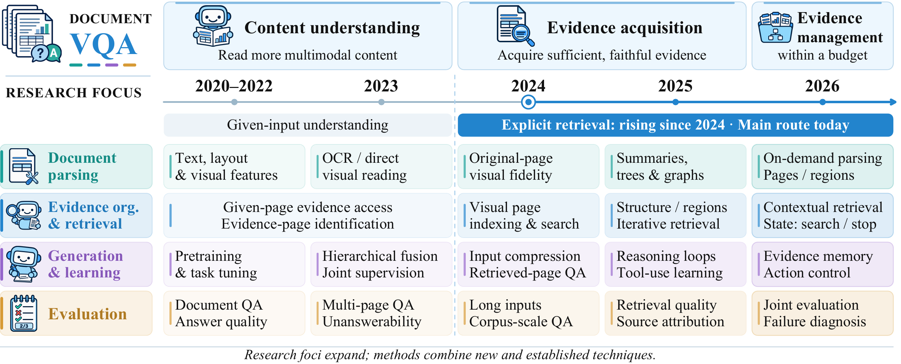

<details>
<summary><strong>Figures 3–6 · Component-level motivations and technical responses</strong></summary>

**Figure 3 · Document parsing**

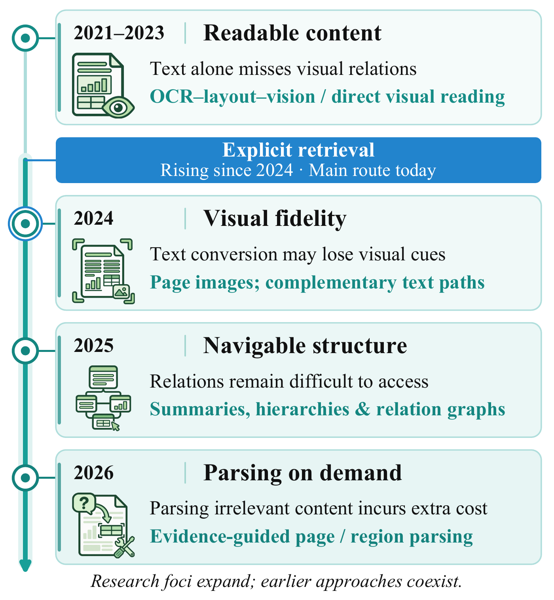

**Figure 4 · Evidence organization and retrieval**

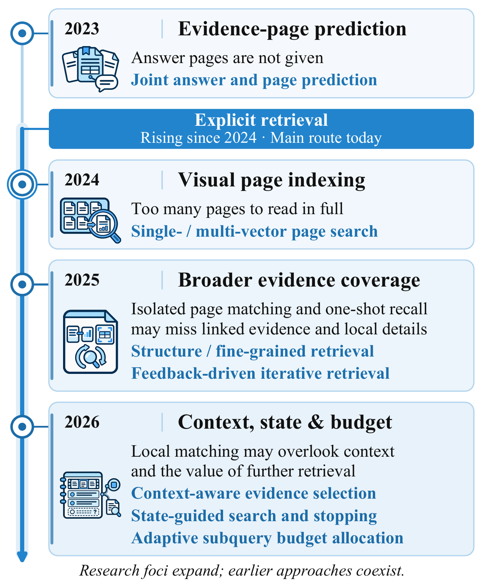

**Figure 5 · Generation and learning**

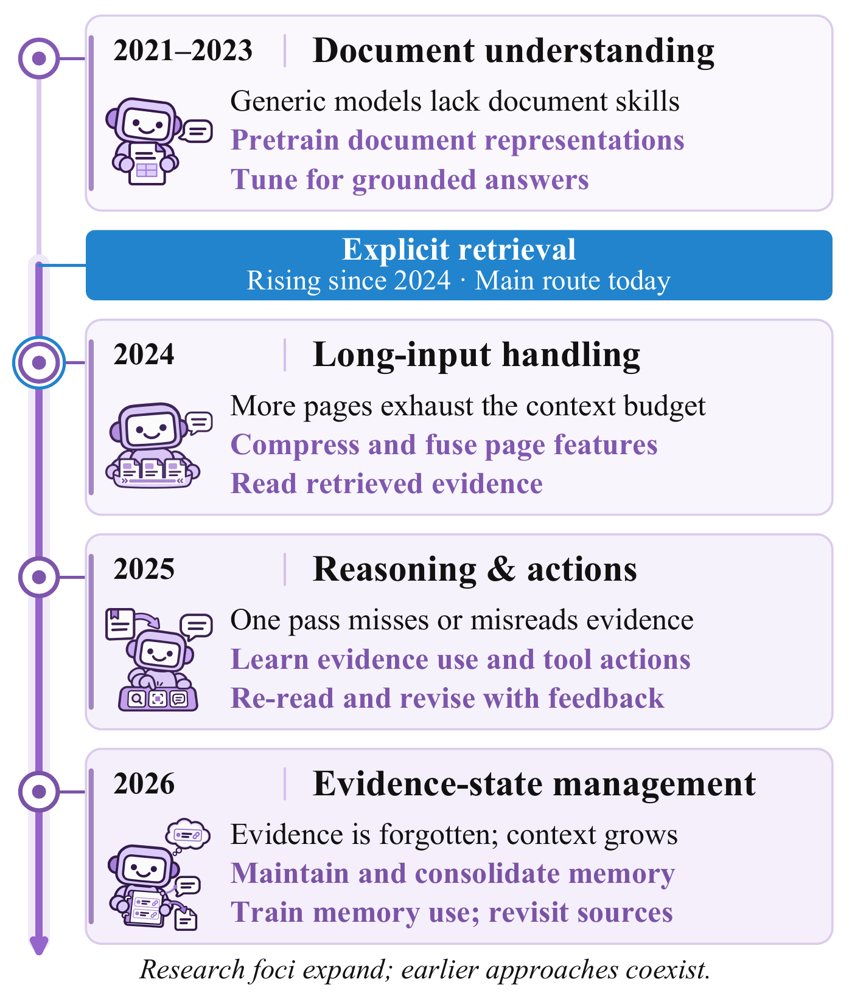

**Figure 6 · Benchmarks and evaluation**

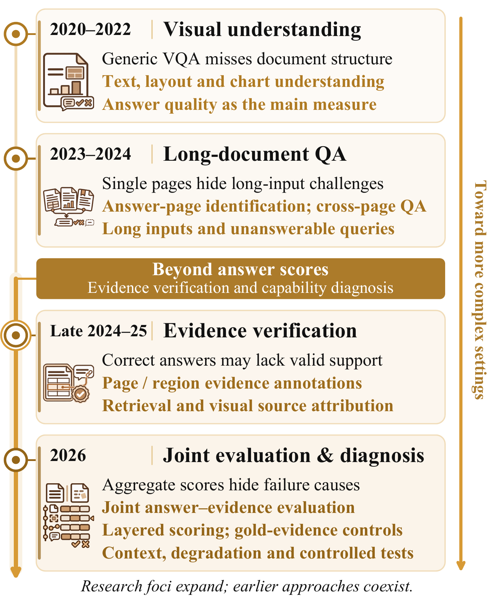

</details>

### Reliable and efficient answers to individual questions

- **Evidence sufficiency:** Construct complementary evidence sets and assess missing support, beyond local relevance.
- **Verifiable and correctable understanding:** Connect source tracing, process verification, and correction of errors and dependent judgments.
- **Budget-aware coordination:** Use evidence states and remaining budgets to coordinate acquisition, reading, verification, and stopping; assess answer quality against end-to-end cost.

### Toward continual document understanding

- **Memory reuse across questions:** Reuse evidence and interaction history, checking applicability and revising memory after corrections or document updates.
- **Strategy improvement across tasks:** Learn transferable retrieval, reading, and verification procedures from experience; validate them on independent tasks before updating agents or skills.

<details>
<summary><strong>Figures 8–9 · Research opportunities at both levels</strong></summary>

**Figure 8 · Answering individual questions**

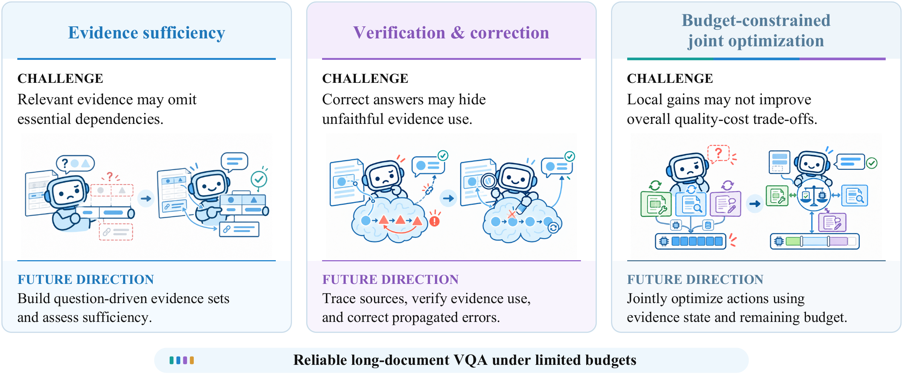

**Figure 9 · Continual document understanding**

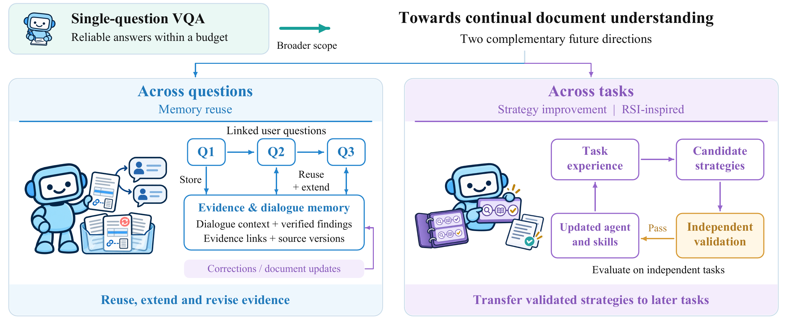

</details>

Section 4 and Appendix D develop these directions into concrete opportunities for system design and evaluation.

## Citation

If you find this survey useful, please cite it. This entry will be updated after the arXiv release.

```bibtex
@unpublished{tong2026taskcentric,
  title  = {A Task-Centric Survey of Long-Document Visual Question Answering: Taxonomy, Evolution, and Future Directions},
  author = {Tong, Yufei and Cheng, Guanjie and Wu, Tianle and Zhang, Leilei and Zheng, Hang and Wu, Peihan and Yin, Jianwei and Deng, Shuiguang},
  year   = {2026},
  note   = {Manuscript},
  url    = {https://github.com/yufeiTongZJU/Long-Document-VQA-Survey}
}
```

## Contact and license

Our original content is licensed under [CC BY 4.0](LICENSE). Linked resources retain their own licenses.

**Suggestions and corrections:** Please [open an issue](https://github.com/yufeiTongZJU/Long-Document-VQA-Survey/issues/new?template=paper-or-correction.md) to suggest relevant papers, correct entries, or report broken links.
